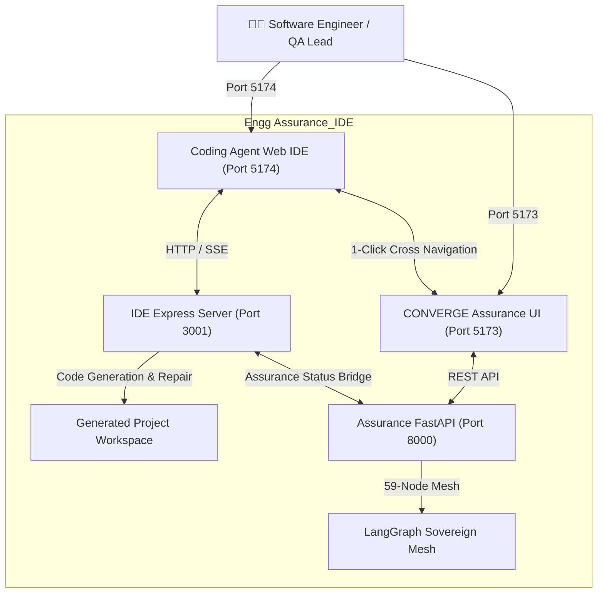

# Engg Assurance_IDE

> **Unified Autonomous Engineering Assurance & AI Coding Agent IDE Platform**  
> *Combining sovereign full-stack code generation with 59-node LangGraph assurance, compliance certification, and financial release governance.*

---

## 🏛 Architecture Overview

`Engg Assurance_IDE` fuses two enterprise-grade AI systems into a single monorepo:

1. **Coding Agent IDE (`coding_agent/`)**:
   - **IDE Express Server (Port 3001)**: Multi-agent generation orchestrator, AST repair engine, contract validators, and real-time execution telemetry.
   - **Monaco Web IDE (Port 5174)**: VS Code-grade in-browser editor, interactive terminals, project tree, PRD intake, and live app previews.
   - **Isolated Python Engine (`.venv-ide`)**: Python virtual environment for workspace runtime execution and background verification.

2. **CONVERGE Autonomous Engineering Assurance (`engineering_assurance/`)**:
   - **Assurance FastAPI Gateway (Port 8000)**: 59-node LangGraph sovereign mesh with 4 modules (Ingest & Synthesize, Generate & Forge, Certify & Comply, Decide & Optimize).
   - **Assurance Governance Dashboard (Port 5173)**: Mission Launchpad, live 59-node Mesh Observatory, HITL approval gate, Release Command Center, and executive economics.



---

## 🚀 Port Mappings & Services

| Service | Port | Directory | Description |
|---|---|---|---|
| **IDE Frontend** | `http://localhost:5174` | `coding_agent/apps/ide-frontend` | Monaco editor, live file tree, terminal, PRD intake |
| **IDE Backend** | `http://localhost:3001` | `coding_agent/server` | Express API, LLM orchestrator, repair engine |
| **Assurance Frontend** | `http://localhost:5173` | `engineering_assurance/frontend` | Mission Launchpad, Mesh Observatory, Command Center |
| **Assurance Backend** | `http://localhost:8000` | `engineering_assurance/backend` | FastAPI 59-Node mesh, compliance, RAG, economics |

---

## ⚡ Quick Start

### 1. Run Everything Concurrently
To start all 4 services (IDE Frontend + IDE Backend + Assurance Frontend + Assurance Backend):
```bash
npm run dev:all
```

### 2. Run Individual Stacks
- **IDE Stack Only (Ports 5174 & 3001)**:
  ```bash
  npm run dev:ide
  ```
- **Assurance Stack Only (Ports 5173 & 8000)**:
  ```bash
  npm run dev:assurance
  ```

---

## 🧪 Testing & Validation

Run the test suites across the merged workspace:

```bash
# Run IDE test suite
npm run test

# Run regression suite
npm run test:ide:regressions

# Run assurance suite
npm run test:assurance

# Run bi-directional assurance bridge suite
npm run test:bridge

# Run all merged test suites
npm run test:all
```

---

## 🌉 Unified Assurance Bridge Endpoints

The Express server (Port 3001) coordinates bi-directional communication with the CONVERGE 59-Node Mesh (Port 8000):

| Endpoint | Method | Purpose |
|---|---|---|
| `/api/assurance/status` | `GET` | Live health discovery of the 59-Node LangGraph mesh |
| `/api/assurance/mission` | `POST` | Packages active workspace code/PRD and dispatches CONVERGE mission |
| `/api/assurance/tasks/:taskId` | `GET` | Streams real-time LangGraph agent execution progress and topology |
| `/api/assurance/scorecard/:taskId` | `GET` | Aggregates Go/No-Go release decision, compliance pack, and economics |
| `/api/assurance/remediate` | `POST` | Dispatches CONVERGE remediation PR to `repairEngine.js` for 1-click self-healing |
| `/api/converge/*` | `ALL` | Transparent reverse-proxy forwarding directly to FastAPI (Port 8000) |

---

## 📁 Repository Structure

```
Engg Assurance_IDE/
├── package.json                   # Unified root npm orchestrator
├── .env                           # Unified environment configuration
├── README.md                      # Merged project documentation
├── DEVELOPMENT_GUIDE.md           # Engineering and development guide
├── docs/                          # 📚 Central Documentation Hub (All .md & spec files)
│   ├── INDEX.md                   # Complete documentation catalog & quick links
│   ├── JK Study/                  # 🌟 Master Project Study Hub
│   │   └── PROJECT_STUDY.md       # Complete All-in-One Study (Chapters 1 to 8+)
│   ├── USER_MANUAL.md             # Platform user manual & quickstart
│   ├── user_manual11.md           # Complete end-to-end user manual
│   ├── TIER 1 - CORE AGENTS/      # 44 Foundation Layer agent specifications
│   ├── TIER 2 - INTELLIGENCE/     # 10 Intelligence Layer agent specifications
│   ├── TIER 3 - ASSISTIVE/        # 5 Assistive Layer copilot specifications
│   ├── Working_Process/           # WoW, V&V, and maturity guidelines
│   ├── audit_reports/             # Baseline, regression, & safety audits
│   └── reports/                   # Milestone and task completion reports
├── node_modules/                  # Shared root packages junction
├── .venv-ide/                     # Python 3.12 virtual environment junction
│
├── coding_agent/                  # AI Coding Agent IDE
│   ├── apps/ide-frontend/         # Vite + React 19 Monaco Web IDE (5174)
│   ├── server/                    # Node.js Express Backend API (3001)
│   ├── packages/python-engine/    # Python runtime runner
│   ├── tests/                     # Engine and repair unit tests
│   └── server/tests/              # Hardening and regression suites
│
└── engineering_assurance/         # CONVERGE 59-Node Assurance Platform
    ├── backend/                   # FastAPI + LangGraph mesh backend (8000)
    ├── frontend/                  # Vite + React 19 governance dashboard (5173)
    ├── docs/                      # Direct junction to ../docs
    ├── Database/                  # Relational and vector knowledge stores
    └── tests/                     # Assurance graphs & intelligence tests
```
