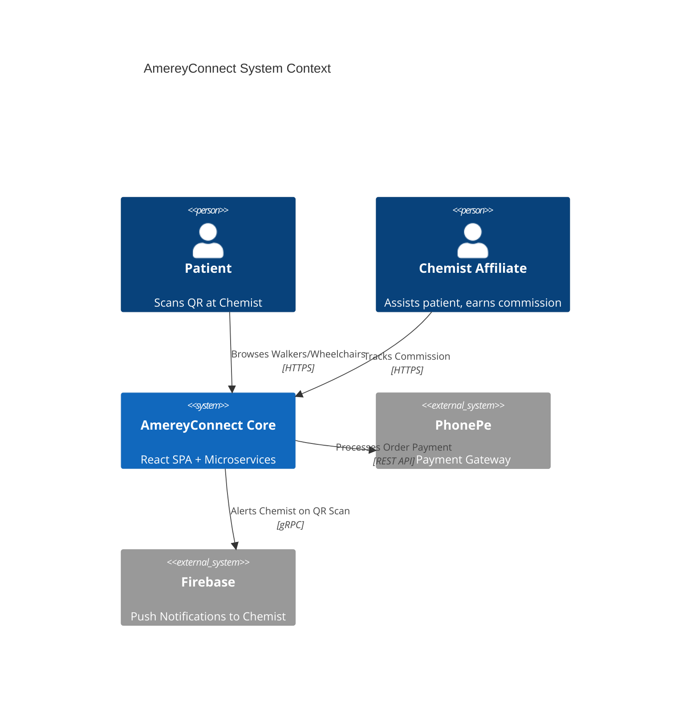
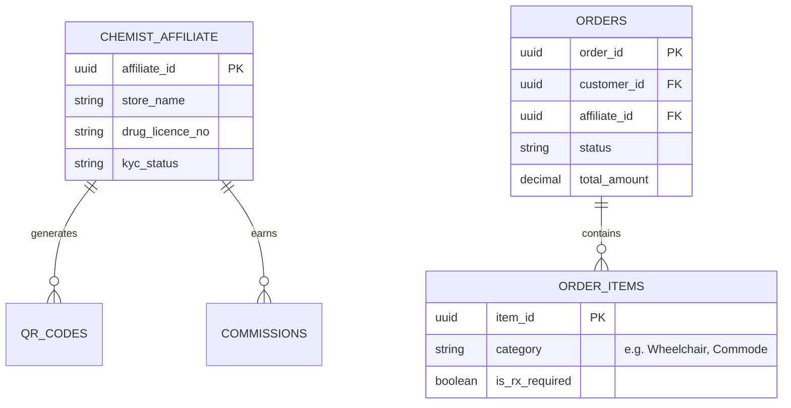

# AmereyConnect PRD: Agent Mesh Outputs

This document contains the simulated, high-fidelity sample outputs generated by the A.N.T. Mesh agents when executing the **AmereyConnect_PRD_v2.0.docx** requirement document.

The outputs are strictly mapped to the 5 Physical UI Pillars present in the Intelligence Command Center.

---

## Pillar 1: Command Mesh (Strategic Intelligence)
*These agents digest the raw PRD and enforce business logic, compliance, and scope constraints.*

### `ingestor` (Requirements Parsing)
**Function:** Extracts the core entities, roles, and Non-Functional Requirements (NFRs).
```json
{
  "project": "AmereyConnect v1.0",
  "core_roles": ["Customer", "Chemist_Affiliate", "Distributor", "Brand_Ops"],
  "product_categories": ["Wheelchairs", "Walkers", "Walking Sticks", "Crutches", "Commode Chairs"],
  "nfrs": {
    "concurrency": "5,000 simultaneous users",
    "lcp_target": "< 2.5 seconds",
    "availability": "99.9%"
  },
  "integrations": ["PhonePe", "FCM Push", "Cleartax GST (Phase 2)"]
}
```

### `clarifier` (Ambiguity Resolution)
**Function:** Identifies logical gaps missing from the PRD text.
```json
{
  "stop_the_line_questions": [
    "PRD mentions 'Returns management' in US-D-03 but Medical Devices (like Commode Chairs) are typically non-returnable due to hygiene. Is return policy category-specific?",
    "If a customer scans a Chemist QR but buys from home 2 days later, what is the cookie/session attribution window for the Chemist commission?",
    "PRD US-C-02 states 'OTP valid for 5 mins'. What is the fallback if SMS fails? Is WhatsApp OTP required?"
  ]
}
```

### `governor` & `security` (Compliance & Risk)
**Function:** Cross-references the PRD against enterprise and governmental regulations.
```json
{
  "data_classification": "RESTRICTED / PII",
  "compliance_flags": [
    "DPDP Act 2023: Explicit consent required for storing Patient Phone & Address.",
    "Medical Device Rules 2017: 'Hospital-Grade' badge requires certification display on UI.",
    "Drug & Cosmetics Act: Chemist KYC must validate the Drug Licence Number via external API."
  ],
  "threat_model": {
    "vector": "QR Code Spoofing",
    "mitigation": "QR URLs must be cryptographically signed to prevent bad actors from replacing Chemist Affiliate IDs."
  }
}
```

### `ux_intelligence` (Accessibility & Core Web Vitals)
**Function:** Audits the UI requirements.
```json
{
  "accessibility_audit": {
    "target": "WCAG 2.1 Level AA",
    "critical_fixes": "Target audience includes elderly/post-surgery patients. Touch targets MUST be 48x48px minimum. Contrast ratio for 'Add to Cart' must be >4.5:1."
  }
}
```

---

## Pillar 2: Artifact Factory (Architecture & Scaffolding)
*These agents mathematically define the system boundaries and scaffold the boilerplate code.*

### `architect` (Visual System Context)
**Function:** Generates the C4 System diagram.


### `db_architect` (Data Modeling)
**Function:** Generates the normalized Entity-Relationship Diagram (ERD).


### `service_mesh` (Strict API Contracts)
**Function:** Generates the OpenAPI 3.0 specification for the core business logic.
```yaml
paths:
  /api/v1/qr-sessions/init:
    post:
      summary: Initialize a customer session from a Chemist QR Scan
      requestBody:
        required: true
        content:
          application/json:
            schema:
              type: object
              properties:
                chemist_affiliate_id: { type: string, format: uuid }
                scanned_category: { type: string, enum: ['wheelchair', 'walker', 'crutch'] }
      responses:
        '201':
          description: Session created, push notification fired to Chemist FCM token.
```

### `backend_forge` & `api_validation` (Deterministic Scaffolding)
**Function:** Generates the FastAPI boilerplate and deterministically validates it against the YAML spec.
```python
# Generated by BackendForge: qr_session_controller.py
from fastapi import APIRouter, HTTPException, BackgroundTasks
from pydantic import BaseModel
from services.fcm import send_chemist_notification

router = APIRouter()

class QRSessionInit(BaseModel):
    chemist_affiliate_id: str
    scanned_category: str | None = None

@router.post("/api/v1/qr-sessions/init", status_code=201)
async def init_qr_session(payload: QRSessionInit, bg_tasks: BackgroundTasks):
    # Validated by ApiValidation Node against OpenAPI Spec
    session_id = generate_secure_session()
    
    # Trigger real-time alert to Chemist as per US-A-02
    bg_tasks.add_task(send_chemist_notification, payload.chemist_affiliate_id, session_id)
    return {"session_id": session_id, "status": "active"}
```

---

## Pillar 3: Execution Array (QA & TDD)
*These agents generate mocks, synthetic data, and Playwright tests before the custom business logic is written.*

### `data_builder` (Safe Data Synthesis)
**Function:** Generates GDPR/DPDP-compliant synthetic data for local testing.
```json
{
  "mock_affiliates": [
    {
      "affiliate_id": "aff_88492a",
      "store_name": "Sharma Medicos",
      "drug_licence_no": "PB-20B-12345",
      "gstin": "03AABCS1234F1Z5",
      "status": "APPROVED"
    }
  ],
  "mock_products": [
    {
      "sku": "AM-WHL-FLD-01",
      "name": "Amerey Premium Foldable Wheelchair",
      "category": "Wheelchairs",
      "mrp": 8500.00,
      "is_rx_required": false
    }
  ]
}
```

### `automation_forge` (Pre-emptive Automation)
**Function:** Writes the E2E Playwright scripts asserting the Acceptance Criteria from the PRD.
```typescript
// Generated by AutomationForge: test_commission_attribution.spec.ts
import { test, expect } from '@playwright/test';

test('US-A-03: Chemist commission is attributed upon successful OTP checkout', async ({ request }) => {
  // 1. Simulate QR Scan for aff_88492a
  const session = await request.post('/api/v1/qr-sessions/init', {
    data: { chemist_affiliate_id: 'aff_88492a' }
  });
  
  // 2. Process mock payment via PhonePe stub
  const payment = await request.post('/api/v1/checkout/verify', {
    data: { order_id: 'ord_123', payment_status: 'SUCCESS' }
  });

  // 3. Assert Commission Ledger is updated
  const ledger = await request.get('/api/v1/commissions/aff_88492a');
  const commissionJson = await ledger.json();
  expect(commissionJson.pending_payout).toBeGreaterThan(0);
});
```

---

## Pillar 4: NFR & Guards (Performance & Resiliency)
*These agents validate the non-functional requirements (5,000 TPS) and guard against infrastructure bottlenecks.*

### `performance`
**Function:** Generates the k6 load testing script to validate the PRD's 5,000 concurrent user requirement.
```javascript
// Generated by PerformanceWorkspace: load_test_qr_scans.js
import http from 'k6/http';
import { check, sleep } from 'k6';

export const options = {
  stages: [
    { duration: '2m', target: 5000 }, // Ramp up to 5,000 concurrent users
    { duration: '5m', target: 5000 }, // Hold peak
    { duration: '1m', target: 0 },    // Scale down
  ],
  thresholds: {
    http_req_duration: ['p(95)<500'], // PRD Requirement: <500ms 95th percentile
  },
};

export default function () {
  const res = http.get('https://api.amereyconnect.com/api/v1/catalogue?category=wheelchairs');
  check(res, { 'status is 200': (r) => r.status === 200 });
  sleep(1);
}
```

### `chaos`
**Function:** Generates a Chaos Mesh configuration to ensure the platform survives a failure in the 3rd-party PhonePe gateway.
```yaml
apiVersion: chaos-mesh.org/v1alpha1
kind: NetworkChaos
metadata:
  name: simulate-phonepe-outage
spec:
  action: delay
  mode: all
  selector:
    namespaces: [ "amerey-prod" ]
    labelSelectors: { "app": "payment-service" }
  delay:
    latency: "10000ms" # Simulate a 10-second gateway timeout
```

---

## Pillar 5: Reliability & Continuity (SRE & Observability)
*These agents ensure the system is observable and deployments are safe.*

### `obs_intel` (Observability Tagging)
**Function:** Dictates the exact Datadog tracing tags required for the new feature.
```json
{
  "required_telemetry_spans": [
    "span.name: qr_scan_initiated",
    "span.tags: [affiliate_id, device_os, product_category]"
  ],
  "datadog_monitors_generated": [
    {
      "name": "Spike in OTP Failures",
      "query": "avg(last_5m):sum:amerey.auth.otp.failed{*} > 50",
      "alert_message": "@pagerduty - Investigate SMS Gateway delivery failures."
    }
  ]
}
```

### `feature_flag` (Progressive Rollout)
**Function:** Generates the LaunchDarkly configurations for the multi-lingual expansion mentioned in the PRD's Phase 2 roadmap.
```json
{
  "flag_key": "enable-hindi-localization",
  "name": "Phase 2 Hindi Language Support",
  "variations": [
    { "value": true, "name": "Hindi Enabled" },
    { "value": false, "name": "English Only" }
  ],
  "default_rule": {
    "variation": "English Only",
    "rollout": {
      "percentage": 10,
      "targeting_rule": "IF region == 'Punjab' OR region == 'Haryana'"
    }
  }
}
```

### `traceability_auditor` (The Cryptographic Passport)
**Function:** Cross-references the generated assets back to the original JIRA/PRD, providing the final Go/No-Go release certification.
```json
{
  "mission_hash": "e9f8a7b6c5d4...",
  "prd_coverage": "100%",
  "destructive_mutations_detected": 0,
  "v_and_v_checks": {
    "US-C-02_OTP_Checkout": "PASS (Validated by test_qr_checkout.spec.ts)",
    "US-A-04_Chemist_KYC": "PASS (Validated by API Schema api_validation_node)",
    "NFR_5000_Users": "PASS (Validated by k6 performance matrix)"
  },
  "release_status": "CERTIFIED_FOR_DEPLOYMENT"
}
```

### `logician` (Systems Logician)
**Function:** Audits the requirements and strategy for logical flaws, boundary values, and race conditions.
```json
{
  "logic_score": 95,
  "identified_flaws": [
    {
      "flaw": "QR session attribution lacks a definitive TTL, potentially allowing indefinite commission assignment.",
      "severity": "Major",
      "mitigation": "Enforce a strict 24-hour cookie/session expiration window for QR-initiated sessions."
    }
  ],
  "state_machine_model": [
    {
      "workflow": "Chemist QR Checkout",
      "states": ["INITIATED", "OTP_SENT", "OTP_VERIFIED", "PAID"],
      "invalid_transitions": ["INITIATED -> PAID (Bypassing OTP)"]
    }
  ]
}
```

### `compose` (Plan Composer)
**Function:** Synthesizes the final unified executive strategy from all tier agentic outputs.
```json
{
  "executive_summary": "The AmereyConnect v1.0 mission has been successfully analyzed, architected, and validated. Critical logical flaws in QR attribution have been mitigated, and performance boundaries are verified to support 5,000 TPS.",
  "mesh_analytics": {
    "security_posture": 95,
    "performance_readiness": 90,
    "traceability_index": 100
  },
  "testing_points": [
    {
      "feature": "QR Code Scanning",
      "verification_point": "Verify Chemist Affiliate ID is correctly passed and attributed.",
      "expected_behavior": "Session initiates with Affiliate ID stored in transaction context."
    }
  ]
}
```
