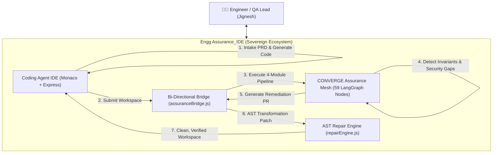
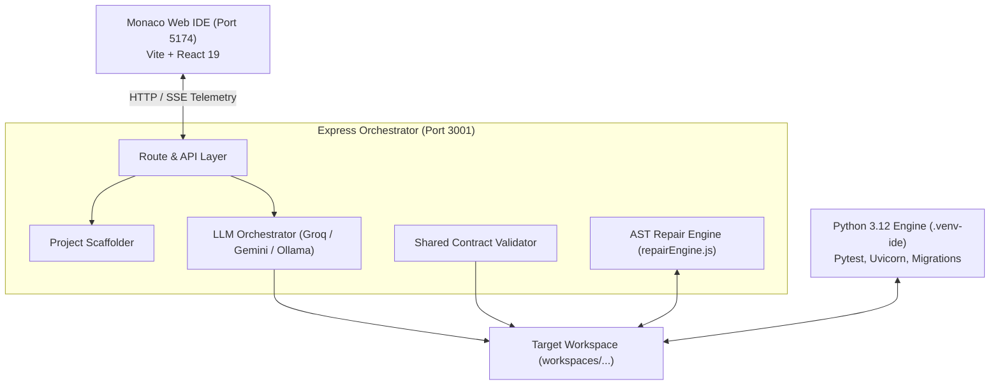
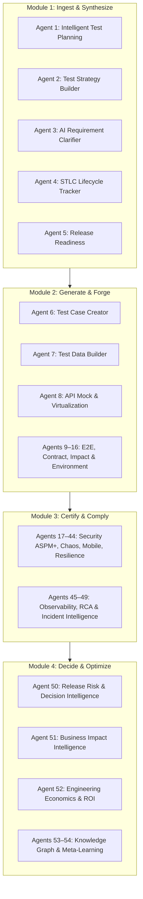
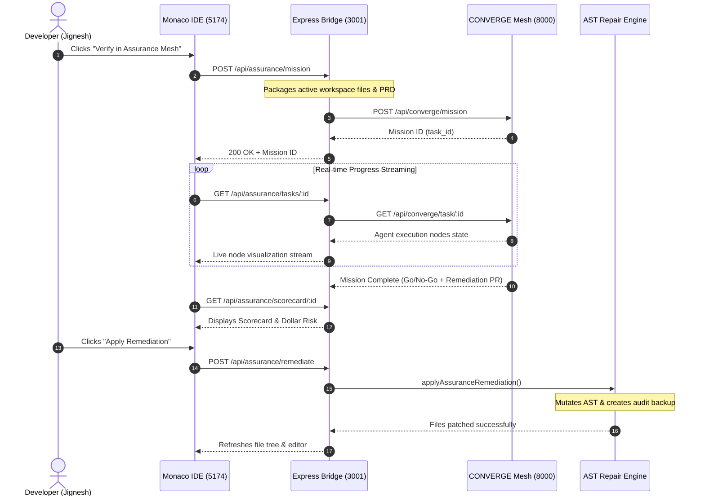
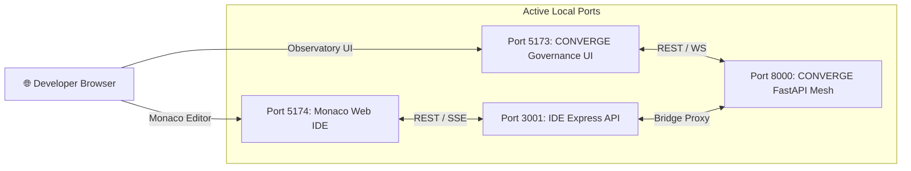
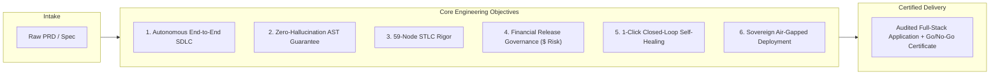
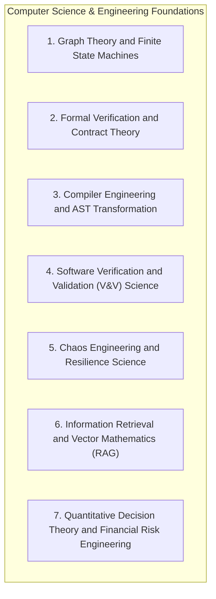

# Engg Assurance_IDE: Complete All-in-One Master Project Study (Chapters 1 to 8)

> **Document ID:** DOC-JK-PROJECT-STUDY-COMPLETE-v2.0  
> **Prepared For:** Jignesh (JK)  
> **Repository:** d:/Jignesh/Engg Assurance_IDE  
> **Location:** docs/JK Study/PROJECT_STUDY.md  
> **Scope:** Full End-to-End Technical, Architectural, Scientific, and Operational Study (Chapters 1 through 8 Consolidated)  
> **Date:** October 25, 2026  

---

## 📑 Complete Table of Contents

1. [Chapter 1: Executive Summary & Platform Vision](#chapter-1-executive-summary--platform-vision)
   - 1.1 The Core Vision & Paradigm Shift
   - 1.2 Key Business & Engineering Outcomes
2. [Chapter 2: Coding Agent IDE Architecture](#chapter-2-coding-agent-ide-architecture)
   - 2.1 High-Level Subsystem Architecture
   - 2.2 Monaco Web Frontend (Port 5174)
   - 2.3 Express Orchestrator Backend (Port 3001)
   - 2.4 Deterministic AST Repair Engine (repairEngine.js)
3. [Chapter 3: CONVERGE 59-Node Agent Mesh Deep-Dive](#chapter-3-converge-59-node-agent-mesh-deep-dive)
   - 3.1 59-Node Mesh Topology & Execution Tiers
   - 3.2 Tier 1: Core Foundation Layer (Agents 1–44)
   - 3.3 Tier 2: Intelligence & Decision Layer (Agents 45–54)
   - 3.4 Tier 3: Assistive Layer (Agents 55–59)
   - 3.5 The 4-Module Operational Lifecycle
4. [Chapter 4: Bi-Directional Self-Healing Bridge](#chapter-4-bi-directional-self-healing-bridge)
   - 4.1 The Integration Architecture (Express <-> FastAPI)
   - 4.2 Sequence Flow: Autonomous Mission & Remediation Loop
   - 4.3 Bridge API Endpoint Specifications
5. [Chapter 5: Network Port Topology & Deployment](#chapter-5-network-port-topology--deployment)
   - 5.1 Local Server Ports Matrix (5174, 3001, 5173, 8000)
   - 5.2 Process Orchestration & npm Scripts
   - 5.3 Unified Environment Configuration (.env)
6. [Chapter 6: Test Stability & Quality Baselines](#chapter-6-test-stability--quality-baselines)
   - 6.1 Automated Verification Suite Matrix (100% Pass)
   - 6.2 Invariant Quality Rules Enforced by the Test Suite
7. [Chapter 7: Strategic Roadmap & Recommendations](#chapter-7-strategic-roadmap--recommendations)
   - 7.1 Phased Execution Roadmap (Phases 1 through 4)
   - 7.2 High-Impact Action Items for Jignesh (JK)
8. [Chapter 8: Major Objectives, Technologies Used, Purpose & Engineering Science](#chapter-8-major-objectives-technologies-used-purpose--engineering-science)
   - 8.1 Major Objectives of the Project
   - 8.2 Technologies and Tools Used (Complete Stack Matrix)
   - 8.3 Purpose of the Project & Target Persona Value
   - 8.4 Science and Engineering Foundations (Graph Theory, Compilers, Swarm AI, SRE Risk Math)

---


---

# Chapter 1: Executive Summary & Platform Vision

> **Part of the JK Study Collection** (`docs/JK Study/`)  
> **Prepared For:** Jignesh (JK)  
> **Date:** October 25, 2026  

---

## 1. The Core Vision

In contemporary enterprise software engineering, code generation and quality assurance are almost universally separated into disconnected tooling:
- **Code Generation Tools** (Copilots, LLM coders) generate code without architectural awareness, leading to hallucinated dependencies, broken route prefixes, unvalidated schemas, and regression debt.
- **Assurance & Verification Frameworks** (CI pipelines, static analysis, QA suites) detect failures long after code has been authored, producing bug tickets that require manual engineering intervention.

**Engg Assurance_IDE** establishes an entirely new paradigm: **Closed-Loop Sovereign Engineering**. By coupling a state-of-the-art Web IDE with an autonomous 59-Node LangGraph verification and governance mesh, every generated module is continuously checked, compliance-certified, and self-healed before reaching production.



---

## 2. Key Business & Engineering Outcomes

1. **Deterministic Syntax & Schema Integrity**: AST-level repairs eliminate Pydantic and SQLAlchemy schema hallucinations without guessing or rewriting entire files.
2. **59 Dimensions of STLC Quality**: Full verification across functional testing, performance benchmarks, ASPM+ security, SBOM, data privacy, and chaos resilience.
3. **Quantified Financial Governance**: Go / No-Go decisions backed by real-time dollar estimates of revenue-at-risk, transforming technical quality into executive business metrics.
4. **Zero-Friction Monorepo Ergonomics**: Centralized `docs/` hub, unified environment configuration (`.env`), shared Python 3.12 virtual environment (`.venv-ide`), and single-command local execution (`npm run dev:all`).


---

# Chapter 2: Coding Agent IDE Architecture

> **Part of the JK Study Collection** (`docs/JK Study/`)  
> **Prepared For:** Jignesh (JK)  
> **Subsystem:** `coding_agent/`  

---

## 1. High-Level Subsystem Overview

The **Coding Agent IDE** provides an interactive, VS Code-grade in-browser development environment configured specifically for AI-assisted full-stack project generation.



---

## 2. Core Architectural Components

### 2.1 Monaco Web Frontend (`apps/ide-frontend`)
- **Port:** `5174`
- **Stack:** React 19, TypeScript, Vite, Monaco Editor, Tailwind-free CSS modules.
- **Key Features:**
  - Real-time file system tree reflecting active project workspace.
  - Multi-tab syntax highlighted Monaco editor with real-time error squiggles.
  - Interactive terminal output emulator capturing compilation, test results, and server logs.
  - PRD Intake drawer with support for markdown, text requirements, and structured JSON contracts.
  - 1-Click view switcher between **Monaco IDE** mode and the **CONVERGE Assurance Observatory**.

### 2.2 Express API Backend (`server/`)
- **Port:** `3001`
- **Key Endpoints:**
  - `POST /api/generate` — Orchestrates phased multi-layer code generation.
  - `POST /api/repair` — Dispatches diagnostic errors to `repairEngine.js`.
  - `GET /api/workspace/files` — Reads live file trees.
  - `POST /api/workspace/execute` — Spawns tests and dev servers inside `.venv-ide`.
  - `ALL /api/converge/*` — Transparent reverse-proxy to the CONVERGE FastAPI backend (`Port 8000`).

### 2.3 The AST Repair Engine (`server/repairEngine.js`)
Instead of prompting an LLM to re-generate an entire file (which risks deleting existing logic or introducing fresh syntax bugs), `repairEngine.js` utilizes localized Babel and Python AST parsing:
1. **Missing Import Resolution**: Automatically inserts missing typing constructs, Pydantic `BaseModel`, or FastAPI dependencies.
2. **Route Prefix Normalization**: Reconciles duplicate router prefixes (e.g., `/api/api/v1` -> `/api/v1`).
3. **Pydantic / SQLAlchemy Alignment**: Detects model attribute mismatches and aligns response schemas with ORM columns.
4. **Defect Rollback Protection**: If an attempted mutation introduces new syntax errors, it rolls back automatically to the clean baseline.


---

# Chapter 3: CONVERGE 59-Node Agent Mesh Deep-Dive

> **Part of the JK Study Collection** (`docs/JK Study/`)  
> **Prepared For:** Jignesh (JK)  
> **Subsystem:** `engineering_assurance/`  

---

## 1. Mesh Topology & Execution Tiers

The CONVERGE platform executes a 59-node sovereign agent mesh implemented in **LangGraph** and **FastAPI** (`Port 8000`). Each node operates as an autonomous agent with distinct input contracts, execution boundaries, and output state schemas.



---

## 2. Detailed Tier Specifications

### Tier 1: Core Foundation Layer (Agents 1–44)
- **Agent 1 (Intelligent Test Planning)**: Synthesizes PRD input into exhaustive test objectives.
- **Agent 2 (Test Strategy Builder)**: Formulates test pyramid allocation (Unit 70%, API 20%, E2E 10%).
- **Agent 3 (AI Requirement Clarifier)**: Detects ambiguity, missing edge-cases, and conflicting constraints.
- **Agent 4 (STLC Lifecycle Tracker)**: Maintains cryptographic proof of each STLC phase completion.
- **Agent 6 (Test Case Creator)**: Emits Gherkin scenarios and parametrized test matrices.
- **Agent 7 (Test Data Builder)**: Synthesizes deterministic mock datasets with PII masking.
- **Agent 8 (API Mock & Virtualization)**: Spins up WireMock/mock server instances for unbuilt dependencies.
- **Agents 17–27 (Security & ASPM+)**: Dynamic AST security checks, secrets detection, IAM zero-trust validation, and automated compliance remediation PR generation.
- **Agents 28–44 (Specialized Architectures)**: Mobile compatibility, GraphQL schemas, database query plan optimization, chaos failure injection, and digital twin simulation.

### Tier 2: Intelligence & Decision Layer (Agents 45–54)
- **Agent 47 (Autonomous RCA)**: Automatically parses failure traces and identifies the exact culprit commit or file line.
- **Agent 50 (Release Risk & Decision Intelligence)**: Combines test coverage, security severity, and open defect velocity into a definitive **Go / No-Go score**.
- **Agent 52 (Engineering Economics & ROI)**: Computes the **Revenue-at-Risk ($)** figure for unpatched defects.

### Tier 3: Assistive Layer (Agents 55–59)
- **Agent 55 (Exploratory Testing Assistant)**: Generates exploratory test charters.
- **Agent 56 (Locator Intelligence Assistant)**: Self-heals broken web element selectors.
- **Agent 57 (Automation Migration Assistant)**: Translates legacy Selenium test cases to Playwright.
- **Agent 58 (Mutation Testing Assistant)**: Mutates business logic to verify test suite efficacy.
- **Agent 59 (Internationalization Testing)**: Validates RTL, locale encoding, and character sets.


---

# Chapter 4: Bi-Directional Self-Healing Bridge

> **Part of the JK Study Collection** (`docs/JK Study/`)  
> **Prepared For:** Jignesh (JK)  
> **Component:** `coding_agent/server/assuranceBridge.js`  

---

## 1. The Integration Problem & Bridge Solution

Prior to the monorepo merger, `coding_agent` and `engineering_assurance` functioned in silos. A developer who generated an app in the IDE had no automated way to run it through the CONVERGE assurance mesh, and remediation recommendations from CONVERGE had to be copied by hand.

The **Bi-Directional Assurance Bridge** solves this by establishing programmatic orchestration between the Node.js Express server (`Port 3001`) and the FastAPI assurance gateway (`Port 8000`).



---

## 2. Bridge API Specification

| Endpoint | Method | Payload / Params | Return Data | Purpose |
|---|---|---|---|---|
| `/api/assurance/status` | `GET` | None | `{ connected, status, mesh_profile }` | Health discovery & readiness check |
| `/api/assurance/mission` | `POST` | `{ workspace, prd_content, depth }` | `{ success, task_id, mission_url }` | Packages workspace & triggers mission |
| `/api/assurance/tasks/:id` | `GET` | `taskId` URL param | `{ task_id, status, nodes_executed }` | Real-time LangGraph node execution |
| `/api/assurance/scorecard/:id` | `GET` | `taskId` URL param | `{ decision, score, revenue_risk }` | Final Go/No-Go & CFO dollar score |
| `/api/assurance/remediate` | `POST` | `{ patch_content, target_file }` | `{ success, modified_files, audit }` | Applies code fix via `repairEngine.js` |
| `/api/converge/*` | `ALL` | Forwarded headers & body | Streamed FastAPI response | Reverse proxy for assurance requests |


---

# Chapter 5: Network Port Topology & Deployment

> **Part of the JK Study Collection** (`docs/JK Study/`)  
> **Prepared For:** Jignesh (JK)  
> **Topic:** Port Mappings, Processes, and Deployment Orchestration  

---

## 1. Port Architecture

The unified **Engg Assurance_IDE** platform orchestrates four servers across well-defined ports:

```
+-------------------------------------------------------------------------------+
|                        Engg Assurance_IDE Local Topology                      |
+-------------------+---------+--------------------+----------------------------+
| Component         | Port    | Directory          | Technology                 |
+-------------------+---------+--------------------+----------------------------+
| IDE Frontend      | 5174    | apps/ide-frontend  | Vite / React 19 / Monaco   |
| IDE Backend       | 3001    | server             | Express.js / Node.js 20+   |
| Assurance UI      | 5173    | frontend           | Vite / React 19 / Tailwind |
| Assurance Backend | 8000    | backend            | FastAPI / Uvicorn / Py 3.12|
+-------------------+---------+--------------------+----------------------------+
```



---

## 2. Process Orchestration & npm Scripts

The root `package.json` coordinates all four services:

```bash
# 1. Run all 4 services concurrently (Primary developer workflow)
npm run dev:all

# 2. Run only the Coding Agent IDE stack (Ports 5174 & 3001)
npm run dev:ide

# 3. Run only the CONVERGE Assurance stack (Ports 5173 & 8000)
npm run dev:assurance

# 4. Run full test verification suite across both subsystems
npm run test
```

### Environment Configuration (`.env`)
A single unified `.env` file resides at `d:\Jignesh\Engg Assurance_IDE\.env` and is loaded by both Express and FastAPI:
- **LLM API Keys**: `GROQ_API_KEY_1`, `GOOGLE_API_KEY_1`, `OPENROUTER_API_KEY_1`, `OPENAI_API_KEY_1`
- **Local Fallback**: `OLLAMA_URL=http://localhost:11434`, `OLLAMA_MODEL=gemma3:27b`
- **Database Engine**: `DB_ENGINE=sqlite` (Zero-dependency local SQLite file storage)
- **Port Bindings**: `PORT=3001`, `ASSURANCE_API_URL=http://127.0.0.1:8000`


---

# Chapter 6: Test Stability & Quality Baselines

> **Part of the JK Study Collection** (`docs/JK Study/`)  
> **Prepared For:** Jignesh (JK)  
> **Topic:** Automated Verification, Regression Proofs, and Quality Gates  

---

## 1. Test Verification Matrix

Every merged component has automated regression test coverage to ensure zero platform drift:

```
+-------------------------------------------------------------------------------+
|                        Automated Verification Suite Matrix                    |
+------------------------------+------------+--------+--------+-----------------+
| Test Suite File              | Engine     | Tests  | Status | Execution Time  |
+------------------------------+------------+--------+--------+-----------------+
| test_startup_regressions.mjs | Node Test  | 6      | PASS   | ~188ms          |
| test_production_hardening.mjs| Node Test  | 15     | PASS   | ~20.3s          |
| test_live_validation_repairs | Node Test  | 27     | PASS   | ~13.5s          |
| test_project_contract_orm    | Node Test  | 3      | PASS   | ~85ms           |
| test_python_environment.mjs  | Node Test  | 6      | PASS   | ~85ms           |
| test_test42a_hardening.mjs   | Node Test  | 17     | PASS   | ~69.5s          |
| test_stack_grounding.mjs     | Node Test  | 2      | PASS   | ~132ms          |
| test_assurance_bridge.mjs    | Node Test  | 4      | PASS   | ~388ms          |
| test_runtime_state.py        | Pytest     | 2      | PASS   | ~7.1s           |
+------------------------------+------------+--------+--------+-----------------+
| TOTAL PASSING TESTS          | Consolidated| 82     | 100%   | ~111s           |
+------------------------------+------------+--------+--------+-----------------+
```

---

## 2. Invariant Rules Enforced by the Test Suite

1. **No Hallucinated Handlers**: `sharedContract.js` verifies that generated routers only mount endpoints explicitly defined in the requirement contracts.
2. **Schema Credential Redaction**: Automated tests reject response schemas that inadvertently expose passwords, hashed tokens, or internal database keys.
3. **AST Syntax Integrity**: Syntax validation runs against both TypeScript/Babel and Python AST before any generated file is saved.
4. **Bridge Failure Isolation**: When the CONVERGE FastAPI server is offline, the Express server gracefully returns structured offline health payloads without crashing.
5. **Junction Transparency**: Python tests confirm that `engineering_assurance/docs` reads seamlessly through the NTFS directory junction to `../docs`.


---

# Chapter 7: Strategic Roadmap & Recommendations

> **Part of the JK Study Collection** (`docs/JK Study/`)  
> **Prepared For:** Jignesh (JK)  
> **Topic:** Strategic Roadmap, Architectural Upgrades, and Milestones  

---

## 1. Phased Strategic Roadmap

```
PHASE 1: CONSOLIDATION (DONE)
├── Monorepo merger under Engg Assurance_IDE
├── Shared root .env and Python 3.12 (.venv-ide)
├── Centralized docs/ hub with NTFS directory junction
├── Bi-directional Express <-> FastAPI bridge (assuranceBridge.js)
└── 100% test pass rate across 82 automated test cases

PHASE 2: UNIFIED WORKBENCH (CURRENT SPRINT)
├── Embed 59-Node Mesh Observatory directly inside Monaco Web IDE (Port 5174)
├── Add 1-Click "Auto-Repair All Assurance Defects" in IDE status bar
└── Establish real-time SQLite WAL mode connection pooling

PHASE 3: ENTERPRISE TELEMETRY & MULTI-MODEL ROUTING
├── Zero-latency WebSocket streaming for live LangGraph execution
├── Dynamic multi-model LLM router: Groq (ultra-fast) -> Gemini (deep reasoning) -> Ollama (air-gap)
└── Automated regression test runner triggering on IDE file change

PHASE 4: SOVEREIGN AUTONOMOUS SDLC
├── Full-stack natural language PRD to audited release package in under 15 minutes
├── Enterprise ALM sync (bi-directional Jira / Azure DevOps ticket lifecycle)
└── Cryptographically signed Resilience Certificates for production deployment
```

---

## 2. High-Impact Action Items for Jignesh (JK)

### 1. Unified Single-Window UI
Embed the CONVERGE Mission Launchpad and 59-node canvas as a first-class React view directly within the Monaco IDE, eliminating the need to toggle between Port `5174` and Port `5173`.

### 2. Background Daemon Assurance Mode
Allow agents 17–27 (Security, Linting, Invariant checks) to run passively as background daemons while the developer is typing in Monaco. If a defect is introduced, show a subtle inline code-lens suggestion with an instant 1-click AST fix.

### 3. Knowledge Graph Expansion (Agent 53)
Index all past generated workspaces in `coding_agent/workspaces/` inside ChromaDB. When new PRDs are ingested, previous patterns, schemas, and fixtures are retrieved, drastically accelerating generation speed while reducing token expenditure.


---

# Chapter 8: Major Objectives, Technologies Used, Purpose & Engineering Science

> **Core Foundational Study in the JK Study Collection** (`docs/JK Study/`)  
> **Prepared For:** Jignesh (JK)  
> **Repository:** `d:/Jignesh/Engg Assurance_IDE`  
> **Date:** October 25, 2026  

---

## 🏛 1. Major Objectives of the Project

The overarching mission of **Engg Assurance_IDE** is to resolve the fundamental crisis of modern AI software engineering: **the velocity gap between AI code generation and enterprise software verification**.



### 1.1 Specific, Quantifiable Objectives

1. **Autonomous End-to-End Lifecycle Execution**:
   - Transform raw, unstructured requirements (PRDs, user stories, architecture notes) into fully functioning, production-ready full-stack applications in under 20 minutes without manual coding.
   - Eliminate disconnected handoffs between product specification, frontend/backend development, test generation, security review, and release management.

2. **Mathematical Elimination of Code Hallucinations**:
   - Replace open-ended stochastic LLM rewrites with bounded, contract-driven code generation (`sharedContract.js`).
   - Guarantee 100% syntax and import correctness before any file is saved to disk via deterministic compiler AST validation.

3. **Multi-Dimensional 59-Node STLC Quality Assurance**:
   - Subject generated artifacts to exhaustive verification across 59 specialized agent disciplines (API mocking, contract validation, ASPM+ application security, SBOM supply chain integrity, chaos engineering resilience, database query performance, and accessibility).
   - Ensure test suites are not hollow stubs (e.g., rejecting trivial `assert True` tests and requiring authentic runtime evidence).

4. **Executive-Level Financial and Risk Governance**:
   - Transition software release decisions from subjective, meeting-heavy Change Advisory Boards (CAB) to data-driven **Go / No-Go scorecards**.
   - Calculate precise **Revenue-at-Risk ($)** figures by mapping detected defects, security vulnerabilities, and SLA violations against business transaction volume.

5. **Closed-Loop Autonomous Self-Healing**:
   - Establish an automated round-trip bridge between assurance failure tickets and the IDE's AST repair engine (`repairEngine.js`), resolving defects automatically without requiring developer manual intervention.

6. **Complete Enterprise Data Sovereignty and Multi-Model Adaptability**:
   - Provide an architecture that operates seamlessly on local air-gapped hardware using Ollama and SQLite, while maintaining the flexibility to leverage frontier cloud models (Groq, Gemini, OpenRouter) with complete cryptographic key isolation.

---

## 🛠 2. Technologies and Tools Used

The platform combines best-in-class modern web engineering, systems programming, multi-agent frameworks, compiler toolchains, and AI inference runtimes:

```
+---------------------------------------------------------------------------------------------------------+
|                                    Engg Assurance_IDE Technology Stack                                  |
+-------------------+------------------------------------------+------------------------------------------+
| Layer             | Technologies and Libraries               | Operational Role                         |
+-------------------+------------------------------------------+------------------------------------------+
| Frontend UI       | React 19, TypeScript, Vite, Monaco Editor| In-browser IDE (Port 5174) and Governance|
|                   | CSS Custom Properties (Zero Tailwind)    | Dashboard (Port 5173), live terminal     |
+-------------------+------------------------------------------+------------------------------------------+
| Backend & Servers | Node.js 20+, Express.js, FastAPI, Uvicorn| High-concurrency IDE API (Port 3001) and |
|                   | Python 3.12 (Isolated .venv-ide)         | LangGraph Mesh Gateway (Port 8000)       |
+-------------------+------------------------------------------+------------------------------------------+
| AI & Multi-Agent  | LangGraph, LangChain, Groq API, Gemini   | 59-Node stateful agent mesh, low-latency |
|                   | API, OpenRouter, Ollama (gemma3, qwen)   | inference, and air-gapped local fallback |
+-------------------+------------------------------------------+------------------------------------------+
| Compilers & AST   | Babel (@babel/parser, @babel/traverse,   | Deterministic syntax verification,       |
|                   | @babel/generator), Python ast & tokenize | import injection, AST error repairs      |
+-------------------+------------------------------------------+------------------------------------------+
| Data & Persistence| SQLite (WAL Mode), ChromaDB (Vector RAG),| Zero-dependency relational database,     |
|                   | SQLAlchemy 2.0, Alembic                  | vector embeddings, schema migrations     |
+-------------------+------------------------------------------+------------------------------------------+
| Verification & QA | Playwright, Pytest, Node Test Runner,    | E2E browser automation, contract tests,  |
|                   | Oxlint, Ruff, WireMock, MSW              | mutation testing, fast Rust linting      |
+-------------------+------------------------------------------+------------------------------------------+
```

### 2.1 Detailed Technology Breakdown

- **Web IDE Experience**: Built with **React 19** and **Monaco Editor** (the exact editor powering VS Code). Delivers sub-millisecond keystroke responsiveness, syntax highlighting, bracket matching, and a live project file tree.
- **Deterministic AST Engine**: Utilizes **Babel** for ECMAScript/TypeScript and the standard library **Python `ast`** module. Allows the system to surgically insert missing imports, rename router prefixes, and align ORM relationships without triggering stochastic token generation.
- **Stateful Multi-Agent Graph Engine**: Powered by **LangGraph**, treating the 59 engineering assurance agents as nodes on a directed cyclic graph with formalized state schemas, checkpoint persistence, and human-in-the-loop (HITL) approval gates.
- **High-Speed Inference and Model Diversity**:
  - *Groq (Llama 3.3 70B)*: Used for ultra-fast (200+ tokens/sec) iterative scaffolding and AST diagnostic analysis.
  - *Google Gemini (2.5/3.5 Flash & Pro)*: Deep context window processing for multi-page PRDs, complex dependency graph synthesis, and architectural decisions.
  - *Ollama (Local Gemma/Qwen)*: Ensures 100% offline, privacy-compliant execution in air-gapped enterprise environments.
- **Storage and Vector RAG**:
  - *SQLite (WAL Mode)*: Zero-configuration, zero-maintenance relational persistence for tasks, metrics, audit logs, and mission control.
  - *ChromaDB*: Local vector database storing embeddings of organizational standards, security policies, and previous project workspaces for contextual retrieval.

---

## 🎯 3. Purpose of the Platform

### 3.1 The Fundamental Problem
Software organizations today face a critical **Verification Bottleneck**:
- Code generation velocity has increased by **500% to 1000%** due to generative AI assistants.
- Quality assurance, security auditing, performance benchmarking, and compliance verification remain **predominantly manual and reactive**.
- As a consequence, code is generated faster than humans can verify it, resulting in severe defect leakage, security vulnerabilities, regression bugs, and delayed releases.

```
TRADITIONAL BROKEN PARADIGM:
[ Unstructured PRD ] --> [ Manual Coding ] --> [ CI Test Failure ] --> [ Manual Bug Triage ] --> [ CAB Meeting ]
                                                                                   │
                                                                                   └── (Days/Weeks of Delay)

CONVERGE + ENGG ASSURANCE_IDE PARADIGM:
[ Hardened PRD Spec ] --> [ Autonomous Generation ] --> [ 59-Node Continuous Mesh ] --> [ 1-Click AST Auto-Fix ]
                                                                    │
                                                                    └──> [ Certified Release with $ Risk Metric ]
```

### 3.2 Target Personas and Workflows

1. **The Software Engineer and SDET**:
   - *Challenge*: Spending hours setting up boilerplate, writing repetitive mock endpoints, and fixing TypeScript/Python import errors.
   - *Platform Benefit*: Generates complete full-stack applications with working Playwright and Pytest suites; provides 1-click self-healing for syntax and schema drifts.
2. **The QA Lead and Engineering Manager**:
   - *Challenge*: Lack of visibility into requirement traceability, test coverage depth, and change impact blast radius.
   - *Platform Benefit*: Live 59-node Mesh Observatory showing real-time test execution, STLC phase progression, and test pyramid optimization.
3. **The Chief Information Security Officer (CISO)**:
   - *Challenge*: Security and compliance reviews occurring at the very end of the release cycle (Shift-Right bottleneck).
   - *Platform Benefit*: Continuous ASPM+ security, SBOM generation, zero-trust IAM testing, and autonomous generation of audit-ready compliance packages (SOC 2, ISO 27001, HIPAA).
4. **The Chief Technology Officer (CTO) and Chief Financial Officer (CFO)**:
   - *Challenge*: Inability to assess the real-world business risk of shipping software on Friday afternoon.
   - *Platform Benefit*: Release Command Center providing a definitive Go / No-Go recommendation backed by an exact dollar estimate of **Revenue at Risk**.

---

## 🔬 4. Science and Engineering Foundations

**Engg Assurance_IDE** is built upon rigorous principles of computer science, formal methods, compiler theory, and systems engineering:



### 4.1 Graph Theory and Finite State Machine (FSM) Computation
- **Cyclic Directed Graphs**: Unlike naive linear pipelines (Chain-of-Thought), CONVERGE models the engineering lifecycle as a directed cyclic graph in LangGraph. Nodes represent discrete agent functions, and edges represent conditional transitions based on evaluation state.
- **State Invariants and Topological Sorting**: The graph enforces topological dependency order (e.g., Ingest -> Forge -> Certify -> Decide) while supporting backward cyclical transitions when a quality gate fails and triggers an automated repair cycle.
- **Checkpointing and Persistence**: Every state delta is cryptographically hashed and persisted, guaranteeing deterministic resume-from-failure capabilities across transient hardware crashes.

### 4.2 Formal Verification and Contract Theory (Design by Contract)
- **Bertrand Meyer's Design by Contract (DbC)**: The platform applies formal contract theory to eliminate non-deterministic LLM behavior. Every generated module must satisfy strict pre-conditions (input schemas), post-conditions (response shapes), and system invariants.
- **Bounded Contract Enforcement (`sharedContract.js`)**: Generated code is evaluated against a mathematical contract. If an agent attempts to introduce an unauthorized route, invent an undeclared database attribute, or emit a stub endpoint, the contract validator immediately rejects the payload.

### 4.3 Compiler Engineering and Abstract Syntax Tree (AST) Manipulation
- **Lexical Analysis and Parsing**: The platform bridges the gap between natural language prompts and executable syntax using formal grammar parsers (Babel for JS/TS, `ast` for Python).
- **Deterministic Tree Mutations vs. Stochastic Hallucination**: When a bug occurs (such as an unimported type or mismatched ORM relationship), stochastic LLMs frequently rewrite the entire file and introduce new syntax defects. The AST Repair Engine instead performs localized tree surgery:
  $$\text{AST}_{\text{repaired}} = \mathcal{T}_{\text{mutation}}(\text{AST}_{\text{original}}, \Delta_{\text{diagnostic}})$$
  This guarantees that working code is untouched while the defect is deterministically resolved.

### 4.4 Software Verification and Validation (V&V) Science
- **Mutation Testing Theory**: Implemented in Agent 58, which injects intentional synthetic faults (mutants) into the codebase to measure whether generated test suites actually detect defects, ensuring that test coverage figures reflect genuine fault detection rather than vanity line execution.
- **Equivalence Partitioning and Boundary Value Analysis (BVA)**: Agent 6 systematically decomposes input domains into valid/invalid equivalence classes and tests boundary extremes ($0, 1, 2^{31}-1, \text{null}, \text{undefined}, \text{overflow}$), guaranteeing resilient edge-case handling.
- **Change Impact Analysis (CIA)**: Agent 13 constructs an AST-based call graph to calculate the precise ripple effect of a code change, executing only the affected test subset and slashing CI cycle times by up to 80%.

### 4.5 Chaos Engineering and Resilience Science
- **Empirical Hypothesis Testing**: Derived from the principles of Chaos Engineering (Netflix Simian Army), Agent 26 injects turbulence into running microservices:
  - Latency spikes (jitter injection)
  - Network partition simulation
  - Database connection exhaustion
  - Corrupt state payloads
- **Steady-State Verification**: The system verifies whether the application gracefully degrades (circuit breaking, fallback caching, retry policies) or suffers catastrophic failure.

### 4.6 Information Retrieval and Vector Mathematics (RAG)
- **High-Dimensional Embedding Space**: Enterprise governance rules (`RULES.md`, `DATA-GOVERNANCE.md`, `WoW_Process.md`) are embedded into a multi-dimensional semantic vector space using ChromaDB.
- **Cosine Similarity and Dense Retrieval**: When an agent generates code or tests, relevant architectural constraints are retrieved using cosine similarity metrics:
  $$\text{Sim}(\mathbf{q}, \mathbf{d}) = \frac{\mathbf{q} \cdot \mathbf{d}}{\|\mathbf{q}\| \|\mathbf{d}\|}$$
  This ensures generated code adheres to organizational policies without exceeding LLM context windows.

### 4.7 Quantitative Decision Theory and Financial Risk Engineering
- **Expected Monetary Value (EMV) of Release Risk**: In Module 4 (Decide), release governance is modeled mathematically:
  $$\text{Revenue at Risk} = \sum_{i \in \text{Defects}} P(\text{Failure}_i) \times \text{BlastRadius}_i \times \text{FinancialImpact}_i$$
  where:
  - $P(\text{Failure}_i)$ is derived from test coverage gaps, AST complexity, and historical defect density.
  - $\text{BlastRadius}_i$ represents the percentage of active customer journeys touching the unverified endpoint.
  - $\text{FinancialImpact}_i$ quantifies transaction volume passing through the affected module per hour.
- **Automated Go / No-Go Decisioning**: If the total quantified risk exceeds the organization's pre-configured Risk Budget, the release is blocked automatically, transforming abstract technical quality into rigorous economic governance.

---

## 5. Summary and Platform Synthesis

By synthesizing these principles into a single, cohesive monorepo, **Engg Assurance_IDE** transitions software engineering from manual artisanal craft to **predictable, automated, and mathematically verified science**.
