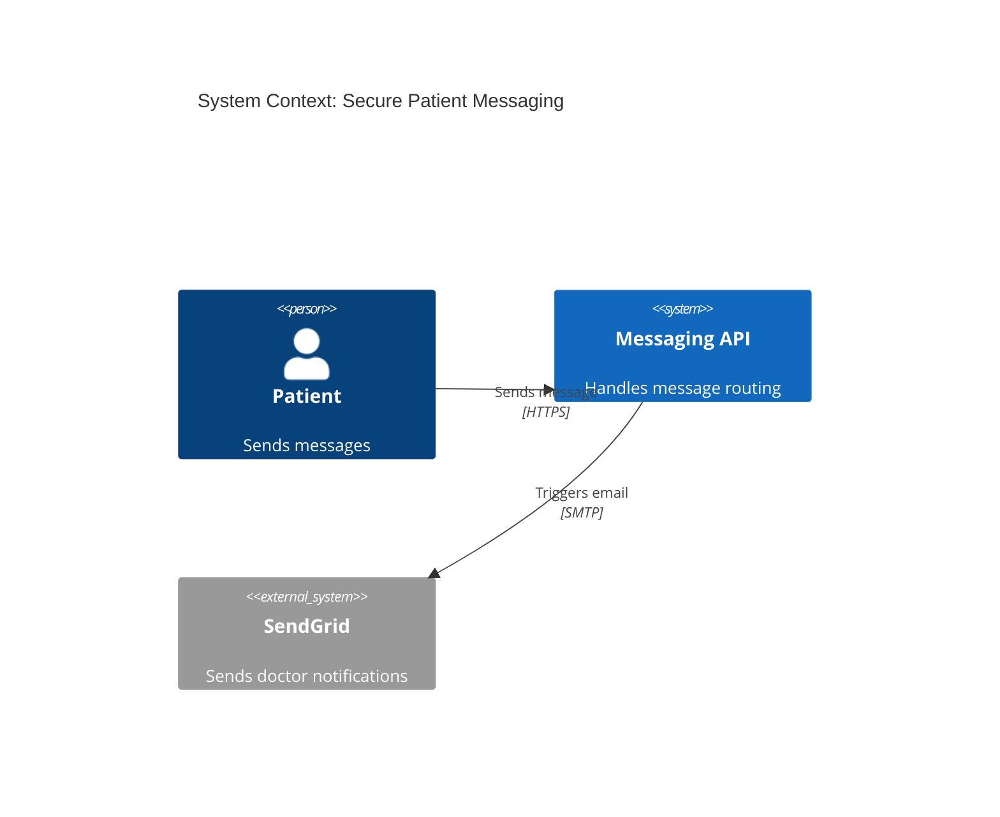
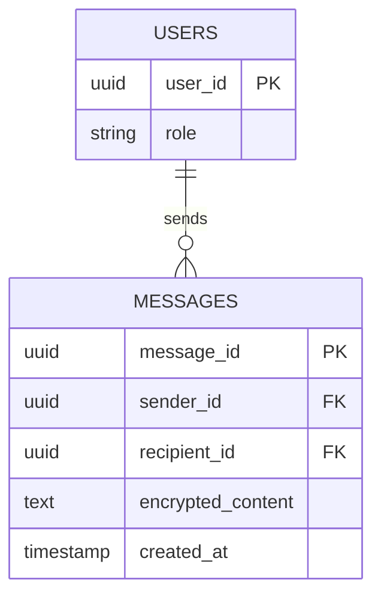

# A.N.T. Mesh Execution: Preventive Engineering Assurance Guide

The A.N.T. (Autonomous Network Topology) Mesh is a 59-agent orchestration pipeline designed fundamentally as an **Enterprise Development Operating System** and a **Preventive Intelligence Platform**. 

As outlined in the overarching Developer Specific Implementation Plan, the Mesh acts as a proactive gatekeeper throughout the Software Development Life Cycle (SDLC). By analyzing inputs *before* development begins, the Mesh enforces constraints, resolves ambiguities, and generates strict contracts to proactively prevent human error and architectural drift.

To illustrate how developers interact with these agents, this guide threads a **Hypothetical Case Study** through the entire Mesh.

---

## The Case Study Input
A Product Manager submits the following JIRA Epic into the A.N.T. Mesh:

> **JIRA-104: Secure Patient Messaging System**  
> "As a patient, I need to send direct messages to my doctor. Messages must be encrypted at rest, and doctors need to receive an email notification when a new message arrives. HIPAA compliance is mandatory. The messaging API needs to handle 5,000 concurrent active users."

---

## Phase 1: Strategic Intelligence & Preventive Requirements
**Proactive Goal:** Eliminate logic gaps and compliance risks before architecture design begins.

### `ingestor` (Requirements Parsing)
* **Function:** Standardizes scattered, human-written text into strict, machine-readable constraints.
* **Proactive Measure:** Prevents developers from missing hidden non-functional requirements (NFRs).
* **Sample Output:**
```json
{
  "functional_requirements": [
    "Patient can send direct messages to Doctor",
    "System sends email notification to Doctor on new message"
  ],
  "nfrs": [
    "Encryption at rest required",
    "Must support 5,000 concurrent active users"
  ],
  "compliance_flags": ["HIPAA"]
}
```

### `clarifier` (Ambiguity Resolution)
* **Function:** Employs adversarial reasoning to find missing edge cases.
* **Proactive Measure:** Forces the team to address implicit gaps upfront, preventing "patchwork" logic later.
* **Sample Output:**
```json
{
  "clarification_required": [
    "Can patients attach files (PDFs/Images) to the messages?",
    "Is there a maximum character limit for a single message?",
    "What is the data retention policy for deleted messages?"
  ]
}
```

### `governor` & `security` (The Stop-The-Line Guardrail)
* **Function:** Acts as the Enterprise Risk Officer.
* **Proactive Measure:** Scans for regulatory triggers. If "Restricted/PII" data is detected, it trips a **Stop-The-Line guardrail**, forcing explicit Human-In-The-Loop (HITL) approval.
* **Sample Output:**
```json
{
  "data_classification": "RESTRICTED / PHI",
  "risk_tier": "CRITICAL",
  "compliance_violations_prevented": 0,
  "guardrail_status": "HITL_APPROVAL_REQUIRED",
  "threat_model_summary": "High risk of unauthorized PHI access. Enforce strict RBAC on GET /messages."
}
```

---

## Phase 2: Proactive Architecture & Contract-Driven Design
**Proactive Goal:** Mathematically define the system boundaries before scaffolding code.

### `architect` (Visual System Context)
* **Function:** Visually maps external dependencies and microservice boundaries.
* **Proactive Measure:** Prevents integration nightmares by explicitly defining service boundaries.
* **Sample Output:**


### `service_mesh` (Strict API Contracts)
* **Function:** Generates an exhaustive OpenAPI specification.
* **Proactive Measure:** Prevents API mismatches between frontend and backend teams.
* **Sample Output:**
```yaml
paths:
  /api/v1/messages:
    post:
      summary: Send a secure message
      security:
        - BearerAuth: []
      requestBody:
        required: true
        content:
          application/json:
            schema:
              type: object
              properties:
                recipient_id: { type: string, format: uuid }
                encrypted_body: { type: string }
      responses:
        '201':
          description: Message sent successfully
```

### `db_architect` (Data Modeling)
* **Function:** Generates highly normalized Entity-Relationship Diagrams (ERDs).
* **Proactive Measure:** Prevents data anomalies by establishing a mathematically sound schema upfront.
* **Sample Output:**


---

## Phase 3: Preventive Generative Forges (Scaffolding)
**Proactive Goal:** Generate highly constrained, contract-compliant boilerplate code.

### `engineering_contract` (The Contract & TDD Guardrail)
* **Function:** Generates strict Acceptance Criteria.
* **Proactive Measure:** The Mesh **physically blocks** the Forges from executing until these V&V contracts are accepted by the developer.
* **Sample Output:**
```json
{
  "acceptance_criteria": [
    "GIVEN a valid patient token, WHEN sending a message, THEN return 201 Created.",
    "GIVEN a missing payload, WHEN sending a message, THEN return 400 Bad Request.",
    "GIVEN a message sent, THEN the database must store it with AES-256 encryption."
  ]
}
```

### `backend_forge` (Constrained Code Generation)
* **Function:** Bootstraps the application code explicitly bound to the Phase 2 contracts.
* **Proactive Measure:** Developers start with a structurally perfect baseline, eliminating "blank canvas" syntax errors.
* **Sample Output:**
```python
# Generated by BackendForge: messaging_controller.py
from fastapi import APIRouter, Depends, HTTPException
from pydantic import BaseModel
from auth import verify_hipaa_token

router = APIRouter()

class MessagePayload(BaseModel):
    recipient_id: str
    encrypted_body: str

@router.post("/api/v1/messages", status_code=201)
async def send_message(payload: MessagePayload, token=Depends(verify_hipaa_token)):
    # TODO: Implement business logic and SendGrid trigger here
    return {"status": "Message sent successfully"}
```

### `api_validation` (Deterministic Contract Enforcement)
* **Function:** Runs deterministic JSONSchema validations (no LLMs involved).
* **Proactive Measure:** Fails the build if the Forge code deviates from the OpenAPI contract.
* **Sample Output:**
```json
{
  "validation_status": "PASS",
  "endpoint": "POST /api/v1/messages",
  "schema_match": true,
  "errors": []
}
```

---

## Phase 4: Proactive Quality Assurance (Shift-Left Testing)
**Proactive Goal:** Generate the entire QA apparatus *before* developers write custom logic.

### `data_builder` (Safe Data Synthesis)
* **Function:** Generates realistic, anonymized synthetic data.
* **Proactive Measure:** Prevents cloning sensitive production databases to local machines, mitigating data privacy breaches.
* **Sample Output:**
```json
[
  {
    "user_id": "usr_9a8b7c6d",
    "role": "patient",
    "mock_encrypted_content": "U2FsdGVkX1+x89a..."
  }
]
```

### `automation_forge` (Pre-emptive Automation)
* **Function:** Writes the physical Playwright/Pytest automation scripts.
* **Proactive Measure:** Enforces Test-Driven Development (TDD). Developers must write their code to pass these pre-existing tests.
* **Sample Output:**
```python
# Generated by AutomationForge: test_messaging.py
import pytest
import requests

def test_send_secure_message_success(auth_token, mock_data):
    headers = {"Authorization": f"Bearer {auth_token}"}
    payload = {"recipient_id": "dr_123", "encrypted_body": mock_data["message"]}
    
    response = requests.post("http://localhost:8000/api/v1/messages", json=payload, headers=headers)
    assert response.status_code == 201
```

---

## Phase 5: Preventive SRE & Operations
**Proactive Goal:** Ensure resilience to infrastructure failures and traffic spikes.

### `chaos` & `performance` (The Blast-Radius Guardrail)
* **Function:** Generates JMeter load tests and Chaos Mesh scenarios.
* **Proactive Measure:** Proves the code won't melt under pressure (e.g., verifying the 5,000 concurrent user constraint).
* **Sample Output (Chaos config):**
```yaml
apiVersion: chaos-mesh.org/v1alpha1
kind: NetworkChaos
metadata:
  name: drop-sendgrid-connection
spec:
  action: delay
  mode: all
  selector:
    namespaces:
      - messaging-prod
  delay:
    latency: "5000ms" # Simulates SendGrid API lag to test system timeouts
```

### `feature_flag`
* **Function:** Designs feature flags for safe deployment.
* **Proactive Measure:** Prevents "big bang" release disasters by providing instant rollback capability.
* **Sample Output:**
```json
{
  "flag_key": "enable-secure-messaging",
  "default_variation": "false",
  "rollout_strategy": {
    "type": "percentage",
    "percentage": 10
  }
}
```

---

## Phase 6: Preventive Observability & Assurance
**Proactive Goal:** Ensure the system is continuously monitored and cryptographically certified.

### `obs_intel` (Observability)
* **Function:** Pre-defines the exact OpenTelemetry (OTel) traces and Datadog metric tags.
* **Proactive Measure:** Prevents the "flying blind" scenario during launch day.
* **Sample Output:**
```json
{
  "required_metric_tags": [
    "env:prod",
    "service:messaging_api",
    "data_class:phi",
    "event:message_sent"
  ],
  "alert_triggers": "Alert if P99 latency > 1000ms for POST /messages"
}
```

### `traceability_auditor` (The Cryptographic Passport)
* **Function:** Cross-references all generated code against security standards.
* **Proactive Measure:** If a destructive operation is generated without HITL approval, it blocks the cryptographic passport.
* **Sample Output:**
```json
{
  "passport_status": "APPROVED",
  "traceability_score": "100%",
  "unauthorized_mutations_detected": 0,
  "certification_hash": "a1b2c3d4e5f6..."
}
```

---

## Summary: Operating the Enterprise Assistance Platform
By studying these concrete outputs, developers can see exactly how the A.N.T. Mesh replaces manual boilerplate with mathematically verifiable contracts. 

1. **Invest in the PRD:** The detailed JIRA ticket allowed the Mesh to know it needed AES encryption and HIPAA checks.
2. **Obey the Deterministic Contracts:** Treat the generated OpenAPI specs, ERDs, and JSONSchema validations as uncompromising laws. 
3. **Execute the Pre-Generated Tests:** Integrate the generated `test_messaging.py` and Chaos scripts into your CI/CD pipeline immediately to prove your code's resilience on every `git push`.

---

## UI Alignment: Execution Phases vs. Logical Phases
Currently, the Orchestration Hub UI groups the execution into **2 Macro-Execution Phases** separated by a **Human-In-The-Loop (HITL)** checkpoint. Here is how the 6 logical phases detailed above align with the physical UI design:

### UI Phase 1: "Strategic Blitz Analysis"
* **Covers Logical Phases:** Phase 1 (Strategic Intelligence) and the early parts of Phase 2 (Architecture).
* **Execution:** The mesh automatically runs the `ingestor`, `clarifier`, `architect`, and `governor` nodes.
* **The HITL Pause:** Execution **halts**. The UI presents the generated `Unified Context Contract` and any "Stop-The-Line" alerts (e.g., HIPAA triggers). Developers *must* explicitly approve the architectural constraints before code scaffolding begins.

### UI Phase 2: "Intelligence Command Center"
* **Covers Logical Phases:** Phase 3 (Forges), Phase 4 (QA), Phase 5 (SRE), and Phase 6 (Observability).
* **Execution:** Once the developer clicks "Approve," the mesh executes the remaining ~50 agents in massive parallel branches.
* **UI Representation:** You will see the UI dynamically render "Phase 4: EnvOps" and "Phase 5: V&V Compliance Passport" blocks as the intelligence streams in.

### UI Evolution Roadmap (v8 Codebase)
As we transition to the Enterprise OS defined in the implementation plan, the UI will evolve to match these deeper logical phases:
1. **Red-Green-Refactor Dashboards:** The UI will introduce a `<TDDStatusIndicator />` to visually show how the generated code is failing/passing the Phase 4 automation scripts in real-time.
2. **In-Workspace Sandbox Execution:** We are planning to introduce an `<ExecutionPanel />` that doesn't just show the code, but physically calls a `/execute-sandbox` backend API to run `npm test` or `pytest` directly in the browser.
3. **Conversational Guardrails:** Instead of a single static HITL pause between Phase 1 and 2, the UI will implement dynamic "Micro-Checkpoints". For example, if the `traceability_auditor` detects a destructive database command during Phase 3, it will inject a mid-flight HITL prompt directly into the UI feed.

---

# Appendix A: The UI Agent Workspaces (Developer Reference)

To provide a single reference manual for developers, the A.N.T. Mesh Frontend UI encapsulates over 40 distinct specialist agents into dedicated, interactive **UI Workspaces** (e.g., `<PerformanceWorkspace />`, `<SecurityWorkspace />`). 

Every workspace uses a standardized UI component (`WorkspaceShell.tsx`) to guarantee a consistent developer experience. By understanding this UI architecture and the "Pillars" the workspaces are grouped into, developers can rapidly navigate the Intelligence Command Center.

## The Workspace Shell Anatomy
Every agent's UI Workspace is structured identically:
* **Shell Header:** Displays the Agent Name, its corresponding Pillar Tag, and a real-time status badge (Pending / Executing / Done).
* **Tab Content:** The core artifact output (e.g., Mermaid Diagrams, JSON metrics, Python code blocks).
* **Standalone Invoke CTA:** A critical developer feature. Many workspaces feature a "Primary CTA Button" (e.g., `Run Performance Audit`). This allows developers to manually re-trigger a specific agent in isolation without running the entire 59-node mesh.

## The 5 UI Pillars
Workspaces are strictly categorized into 5 operational Pillars within the UI:

### 1. Command Mesh
**Key Workspaces:** `PlanningAgentWorkspace`, `UXIntelligenceWorkspace`, `TrendAnalystWorkspace`
* **Salient Features:** This pillar holds the Strategic Intelligence agents. These workspaces output the primary directives, UX audits, and scope-creep trend analyses.
* **Developer Leverage:** Visit these workspaces early in the sprint to review the strategic direction. Use the outputs to challenge or refine your Jira epics before coding begins.

### 2. Artifact Factory
**Key Workspaces:** `FrontendForgeWorkspace` (Code), `ServiceMeshWorkspace` (OpenAPI specs), `DbArchitectWorkspace` (ERDs)
* **Salient Features:** Natively renders syntax-highlighted code, JSONSchema, and embedded Mermaid.js architecture diagrams.
* **Developer Leverage:** This is your scaffolding hub. Copy the auto-generated React components, API contracts, and database migration scripts directly from these workspaces into your repository.

### 3. Execution Array
**Key Workspaces:** `AutomationForgeWorkspace`, `ApiCoderWorkspace`, `DataBuilderWorkspace`
* **Salient Features:** Focuses exclusively on Test-Driven Development (TDD) assets. Outputs synthetic mock data, WireMock stubs, and executable Playwright/Pytest scripts.
* **Developer Leverage:** Shift-left your testing. Download the Postman collections from here on Day 1 to unblock UI development, and paste the Playwright scripts into your CI/CD pipeline.

### 4. NFR & Guards
**Key Workspaces:** `PerformanceWorkspace`, `SecurityWorkspace`
* **Salient Features:** Dedicated to Non-Functional Requirements (NFRs). These workspaces display shift-left threat models, JMeter load scripts, and OWASP Top 10 validations.
* **Developer Leverage:** Prior to a major release, use the **Standalone Invoke** CTA in these workspaces to run a targeted performance stress test or security audit on your latest PR branch.

### 5. Reliability & Continuity
**Key Workspaces:** `ChaosWorkspace`, `ObsIntelligenceWorkspace`, `SelfHealingWorkspace`
* **Salient Features:** Outputs Chaos Mesh network-drop configurations, Service Level Objective (SLO) definitions, and OpenTelemetry Datadog tagging rules.
* **Developer Leverage:** Ensure your production environment is fully observable by copying the exact Datadog tracing tags and Incident Runbooks generated here before your feature goes live.
