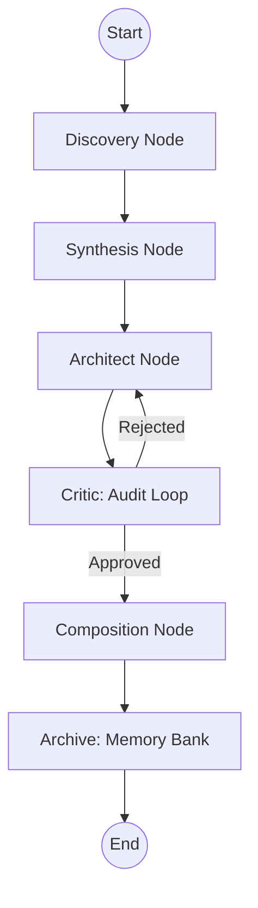

# CONVERGE: Engineering Bible v4.0.0
### [CONVERGE v4.0.0 | 59-Node Sovereign Mesh | 4-Module Product Architecture]

This document is the **single source of truth** for maintaining, extending, and auditing the CONVERGE platform. It defines the absolute structural standards and multi-agent reasoning protocols that power the production-grade CONVERGE platform.

---

## 🏗️ 1. Structure of Framework
The platform is built on a modular, multi-tier architecture designed for high-concurrency ingestion and stateful reasoning.

```text
ai-engineering-assurance-v3/
├── backend/                  # FastAPI Intelligence Core (Hardened)
│   ├── agents/               # Stateful Multi-Agent Orchestration
│   │   ├── nodes.py          # Node logic (Architect, Critic, Compose)
│   │   ├── state.py          # AgentState TypedDict definitions
│   │   └── workflow.py       # LangGraph DAG implementation
│   ├── api/                  # RESTful Layer & Request Validation
│   │   ├── routes/           # Implementation logic for individual API endpoints
│   │   ├── models.py         # Type-safe Pydantic Request/Response schemas
│   │   └── router.py         # APIRouter orchestration & dispatcher
│   ├── core/                 # The "Engine Room" (Core Logic)
│   │   ├── config.py         # Pydantic Settings & Path resolution
│   │   ├── fetcher_factory.py# Universal ALM Connector (Registry Pattern)
│   │   ├── vector_db.py      # ChromaDB Semantic Memory Bank
│   │   ├── identity_orchestrator.py # Multi-tier LLM Identity Vault logic
│   │   ├── test_plan_composer.py    # DOCX Strategic Template engine
│   │   └── utils.py          # Professional Sanitization & Formatting
│   └── main.py               # Entry Point (Production Port 8000)
├── frontend/                 # Shadow-Glass React UI (Vite + TS)
│   ├── src/                  # Glassmorphism Components & Status Polling
│   └── package.json          # Frontend build manifest
├── docs/                     # Technical Specifications
│   ├── engineering_guide.md  # Deep structural breakdown (This Document)
│   └── upgrade_plan.md       # Roadmap for future ALM integrations
└── .env                      # Environment-aware secret management
```

---

## 🏛️ 2. The B.L.A.S.T. Reasoning Protocol
Converge uses a proprietary five-layer reasoning system to transform raw data into industrial-grade strategies.

| Layer | Component | Engineering Responsibility |
| :--- | :--- | :--- |
| **B** | **Business Logic** | Identified from Driving Requirements. Maps user intent to outcomes. |
| **L** | **Logic Nodes** | Extraction of constraints and algorithmic pathways from the Unified Contract. |
| **A** | **Architecture** | Technical stack analysis to determine environment and mock requirements. |
| **S** | **Strategic Testing** | Generation of tiered coverage and Gherkin scenarios. |
| **T** | **Traceability** | Bidirectional mapping between Source IDs and Acceptance Criteria. |

---

## 🕸️ 3. Agentic Network Topology (A.N.T.)
The system is built on **LangGraph**, providing a stateful, fault-tolerant orchestration layer.

### Topology Graph (A.N.T. DAG)


### Node Detailed Logic
1.  **Discovery Node (The Ingestor)**: Orchestrates the `FetcherFactory` parallel mesh across 24+ sources using `ThreadPoolExecutor`.
2.  **Synthesis Node (Unified Context)**: Consolidates sources into the **Unified Context Contract**. Applies heuristic normalization if the LLM output is generic.
3.  **Architect Node (B.L.A.S.T. Engine)**: The primary reasoning tier. Injects **Historical Precedents** from ChromaDB and applies the B.L.A.S.T. protocol to design the strategy.
4.  **Critic Node (The Audit Loop)**: Automated QA specialist. Enforces a **strictly capped 3-iteration cycle** to prevent logic loops. Scans for metric hollow-spots (e.g., <80% coverage).
5.  **Composition Node (Safe-Style Writer)**: Final artifact generation. Uses the `Safe-Style` engine to resolve Word styles dynamically, preventing crashes on missing template metadata.

---

## 🏃 4. Developer Walkthrough (Interaction Lifecycle)

### Step 1: Discovery (The Filter)
- **UI**: `Step1SourceSelection.tsx`.
- **Logic**: User selects platforms. UI checks `connectedPlatforms` (Vault) for "Secure" badges.
- **Developer Note**: Platform IDs in `App.tsx` must match IDs in `FetcherFactory`.

### Step 2: Ingestion (The Mesh)
- **UI**: `Step2DataCollection.tsx`.
- **Backend API**: `POST /api/fetch/requirements`.
- **Chain**: `main.py` → `FetcherFactory` → (Parallel Threads) → `Synthesis Node`.

### Step 3: Refinement (The Human Anchor)
- **UI**: `Step3AnalysisRefine.tsx`.
- **Critical Path**: Manual edits here are the **Absolute Source of Truth** for the Architect agent.

### Step 4: Generation (The Architecture)
- **Backend API**: `POST /api/tasks/generate`.
- **Chain**: LangGraph → Architect → Critic → Compose → Archive Node.
- **UI**: `Step4FinalizeExport.tsx`. Shows the "Reasoning Console" (Live Logs).

---

## 🛠️ 5. How to Extend (Developer Scenarios)

### Adding a New Ingestion Source (e.g., Trello)
1.  **Fetcher**: Create `trello_fetcher.py` in `backend/core/`. Inherit from `BaseFetcher`.
2.  **Factory**: Add to the `fetchers` map in `fetcher_factory.py`.
3.  **Frontend**: Update the `platforms` array in `frontend/src/App.tsx`.

### Adding a New AI Critique Rule
1.  **Prompt**: Modify `CRITIC_PROMPT` in `prompts.py`.
2.  **Node**: Update the `critic_node` function in `nodes.py` to parse for the new rule.

---

## 🔍 6. Troubleshooting & Diagnostics

| Symptom | Probable Cause | Resolution |
| :--- | :--- | :--- |
| **"Failed to Fetch"** | Backend process crashed or port 8000 locked. | Run `npx kill-port 8000` and restart server. |
| **"Identity Failed"** | No keys found in `llm_vault`. | Go to Settings -> Vault and add LLM key. |
| **Empty Results** | ALM API timeout or invalid Ticket ID. | Check `backend/logs` for `FetcherTimeoutException`. |
| **Weak Analysis** | Low temperature or weak LLM model used. | Switch Vault to `Strategic` tier (Llama-70b). |

---

## 🗄️ 7. Persistence Layer Heuristics
- **Semantic Brain**: ChromaDB (L2 Euclidean). 
    - **Threshold**: Confidence Formula: `confidence = max(0, 1 - (l2_dist / 2.0))`.
    - **Deduplication**: A match >90% triggers a "Brain Alert" in the UI, marking the work as potentially redundant.
- **Relational Log**: SQLite WAL mode enabled for parallel state management and real-time polling.

---

## 🔐 8. Identity & Inference Mesh (Circuit Breaker)
Converge uses a unified inference gateway to ensure zero-downtime operations.

- **Identity Failover**: If a primary API key (e.g., Groq) hits a RateLimit (429), the `InferenceCoordinator` automatically **benches the key for 15 minutes** and fails over to the next available identity in the Vault.
- **Translation Layer**: Integrated via **LiteLLM**, allowing seamless transition between Groq (Llama-3), Ollama (Local), and OpenAI without code regressions.
- **Financial Governance**: The system tracks `cost_usd` and `latency_ms` for every reasoning step, exposed via the `/api/llm/health` telemetry endpoint.

---

## 🏺 9. Traceability Mechanics (Marker-Based)
Bidirectional traceability is achieved through **Marker-Based Extraction**:
1.  **Injection**: The Architect is instructed to append `[↩ REQ-XXX]` tokens to every Acceptance Criterion.
2.  **Extraction**: The `extract_traceability_from_output()` utility parses the raw LLM string, isolating the markers from the clean display text.
3.  **Mapping**: A `TraceabilityMap` is built, linking derived AC IDs to original ALM source IDs for the Traceability Matrix UI.

---

## 🎨 10. Safe-Style Resolution Engine
The document composer is hardened against template inconsistency:
- **Style Guard**: Uses `_get_safe_style()` to probe the Word template for required styles (e.g., 'List Bullet', 'Table Grid').
- **Dynamic Fallback**: If a bespoke style is missing from the `.docx`, the system automatically falls back to `Normal` or `TableNormal`, ensuring artifact generation **NEVER** fails due to UI/UX branding mismatches.

---

## 🧠 11. Semantic Memory & RAG Recall
The **Brain** collection in ChromaDB acts as the long-term memory:
- **Context Injection**: During the Architect's reasoning step, related plans are recalled and injected as "Historical Precedents".
- **Learning Loop**: Final, human-approved synthesis is automatically indexed back into the Brain, creating a self-improving intelligence flywheel.


---

## 12. CONVERGE 4-Module Architecture (v4.0.0)

The platform is organized into 4 product modules, each with dedicated API endpoints:

### Module 1 - Ingest & Synthesize
- **Endpoint:** POST /api/converge/ingest
- **Agents:** Ingestor, Clarifier, Compliance Governor, Traceability Auditor, Systems Logician, Lifecycle Tracker
- **Output:** Hardened specification with structured acceptance criteria

### Module 2 - Generate & Forge
- **Endpoint:** POST /api/converge/forge
- **Agents:** Test Case Creator, Data Builder, API Mock, Automation Forge, API Coder, Strategy Builder, Regression, Test Impact
- **Output:** Executable test suite, automation scripts, API mocks, synthetic data

### Module 3 - Certify & Comply
- **Endpoint:** POST /api/converge/certify
- **Agents:** Performance, Security, Reliability Engineering, SLO, Chaos, Self-Healing, UX Intelligence, Env Consistency
- **Output:** Resilience Certificate, Compliance Evidence Package

### Module 4 - Decide & Optimize
- **Endpoint:** POST /api/converge/decide
- **Agents:** Release Risk, Business Impact, ROI Economics, Autonomous RCA, Observability Intelligence
- **Output:** Go/No-Go decision with composite score, revenue-at-risk, ROI model

### Full Mission
- **Endpoint:** POST /api/converge/mission
- **Depth profiles:** rapid (18 nodes), standard (35 nodes), full (59 nodes)

### Aggregation Endpoints (read-only, no new mesh runs)
- GET /api/converge/release-decision/{task_id} - Release Command Center data
- GET /api/converge/economics/{task_id} - Engineering Economics data
- GET /api/converge/compliance-pack/{task_id} - Compliance Evidence Package
- POST /api/converge/knowledge-graph - Semantic knowledge query
- GET /api/converge/mesh-profile - Agent activation preview for Mission Launchpad

---

## 13. New UI Views (v4.0.0)

| View | Route Key | Component | Description |
|---|---|---|---|
| Mission Launchpad | mission_launchpad | MissionLaunchpad.tsx | Module selector, depth picker, role selector, PRD input |
| Mesh Observatory | mesh_observatory | MeshObservatory.tsx | Live 59-node canvas with 4 color-coded module lanes |
| Release Command Center | release_command | ReleaseCommandCenter.tsx | Executive Go/No-Go card with all intelligence signals |
| History & Trends | history | HistoryTrends.tsx | Sprint analytics, sparklines, heatmap, audit log |

### Theme System
- Dark/Light mode toggle in header
- Activated via: document.documentElement.setAttribute('data-theme', 'light')
- CSS defined in App.css under [data-theme="light"] selector
- Persisted to localStorage as 'converge_theme'
---
**Technical Standard: ISO/VVNT-4.0.0 | CONVERGE v4.0.0 | 59-Node Sovereign Mesh**
**Built for the CONVERGE Engineering Standard. VV&T Certified.**
